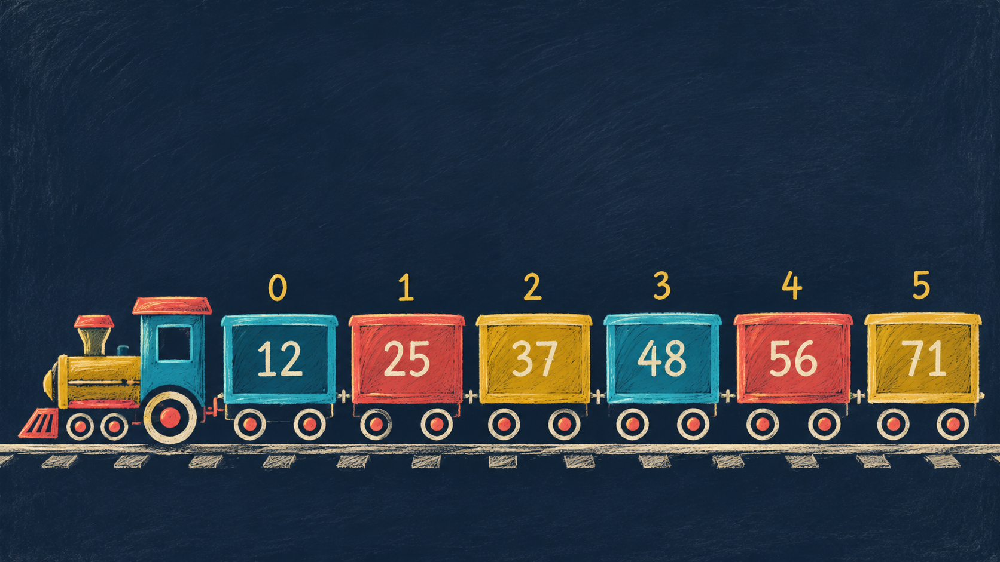
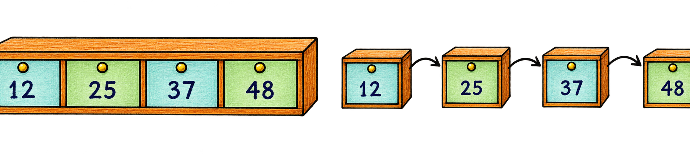
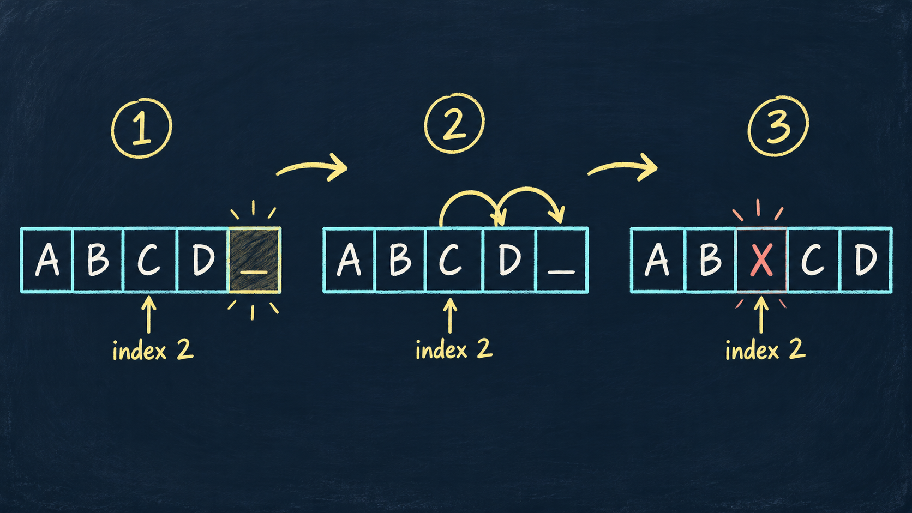
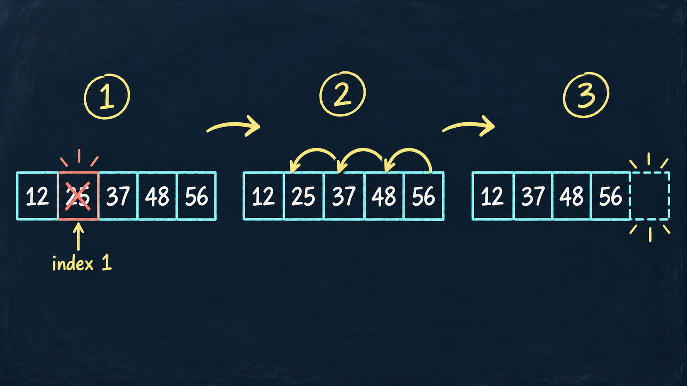
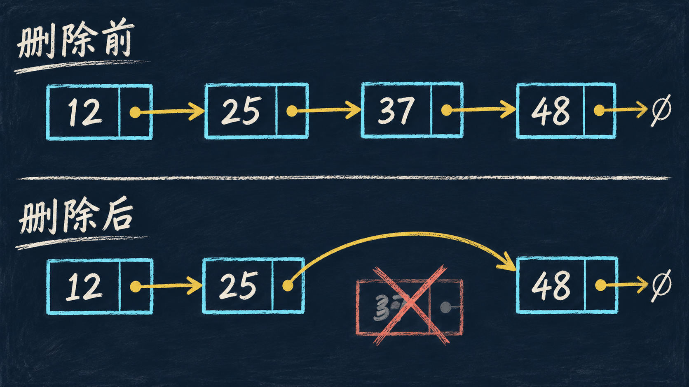

## 本节目标

- 解释线性表的逻辑结构
- 区分顺序表与单链表的存储方式
- 逐步演示插入、删除和访问过程
- 使用 Python 实现并分析基本操作

---

## 从排队理解线性表

:::: {.columns}
::: {.column width="53%"}

线性表是由 $n$ 个数据元素组成的有限序列：

$$L=(a_0,a_1,\ldots,a_{n-1})$$

- 除首元素外，每个元素只有一个直接前驱
- 除尾元素外，每个元素只有一个直接后继
- 元素之间存在明确的先后次序

:::
::: {.column width="47%"}

{.handdrawn width=100%}

:::
::::

---

## 线性表的基本操作

| 操作 | 含义 | Python 表达 |
|---|---|---|
| 初始化 | 建立空表 | `values = []` |
| 访问 | 读取第 $i$ 个元素 | `values[i]` |
| 查找 | 找到满足条件的元素 | `values.index(x)` |
| 插入 | 在位置 $i$ 放入元素 | `values.insert(i, x)` |
| 删除 | 移除位置 $i$ 的元素 | `values.pop(i)` |

::: {.callout-note}
抽象数据类型规定操作的含义，不限定底层必须使用 Python 列表。
:::

---

## 顺序表与单链表

:::: {.columns}
::: {.column width="50%"}

### 顺序表

`[12][25][37][48]`

- 元素占据连续存储单元
- 下标可以直接换算为地址
- 中间插入、删除需要搬移元素

:::
::: {.column width="50%"}

### 单链表

`[12|•]  [25|•]  [37|•]  [48|∅]`

- 节点在内存中可以分散
- 指针保存后继节点地址
- 定位第 $i$ 个元素需要遍历

:::
::::

```{=html}
<figure class="memory-comparison">
  
  <figcaption>连续存储看位置相邻；链式存储看指针相连</figcaption>
</figure>
```

---

## 顺序表的按下标访问

已知元素的 <span class="key-red">下标 $i$</span>，可以直接计算它的存储地址。

若每个元素占 $w$ 个字节，首地址为 $LOC(a_0)$：

$$LOC(a_i)=LOC(a_0)+i\times w$$

```{python}
def address(base, index, width=4):
    return base + index * width

for i in range(4):
    print(f"a[{i}] 的地址 = {address(1000, i)}")
```

::: {.callout-tip}
这里的“随机访问”是指可以直接访问<span class="key-red">任意下标</span>，不是“随机选一个下标”。按下标访问的时间复杂度为 $O(1)$。
:::

---

## 按下标访问与按值查找

| 要解决的问题 | 已知信息 | 访问过程 | 时间复杂度 |
|---|---|---|---|
| <span class="key-red">按下标访问</span> | 下标 $i$ | 直接计算地址 | $O(1)$ |
| <span class="key-red">按值查找</span> | 值 $x$ | 从表头逐个比较 | $O(n)$ |

```{python}
values = [12, 25, 37, 48]

print(values[2])       # 已知下标 2，直接得到 37
print(values.index(37))  # 已知值 37，查找它的下标
```

::: {.callout-tip}
看到“第 $i$ 个”或“下标 $i$”，考虑<span class="key-red">按下标访问</span>；看到“值 $x$ 在哪里”，考虑<span class="key-red">按值查找</span>。
:::

---

## 顺序表插入过程

{.handdrawn width=92%}

::: {.callout-warning}
元素必须从右向左搬移。若从左向右搬移，原数据会被覆盖。
:::

---

## 交互演示：顺序表插入

```{=html}
<div class="demo" id="array-demo">
  <div class="demo-controls">
    <button type="button" data-action="next">下一步</button>
    <button type="button" class="secondary" data-action="reset">重新开始</button>
    <span class="mini-note">目标：在下标 2 插入 X</span>
  </div>
  <div class="array-row"></div>
  <div class="demo-status"></div>
</div>
```


---

## 顺序表插入算法

```{python}
def insert_by_shift(values, index, item, trace=False):
    values = values + [None]  # 扩大一个位置
    if trace:
        print("初始：", values)

    for j in range(len(values) - 1, index, -1):
        values[j] = values[j - 1]
        if trace:
            print(f"移动下标 {j-1} 到 {j}：", values)

    values[index] = item
    if trace:
        print("插入：", values)
    return values

insert_by_shift(["A", "B", "C", "D"], 2, "X", trace=True)
```

最坏情况插在表头，需要移动 $n$ 个元素，时间复杂度为 $O(n)$。

---

## 顺序表删除过程

{.handdrawn width=92%}

::: {.callout-warning}
删除下标 1 后，从它的后继元素开始<span class="key-red">依次向左搬移</span>，最后再缩短表长。
:::

---

## 交互演示：顺序表删除

```{=html}
<div class="demo" id="array-delete-demo">
  <div class="demo-controls">
    <button type="button" data-action="next">下一步</button>
    <button type="button" class="secondary" data-action="reset">重新开始</button>
    <span class="mini-note">目标：删除下标 1 的元素 25</span>
  </div>
  <div class="delete-array-row"></div>
  <div class="move-note"></div>
  <div class="demo-status"></div>
</div>
```

::: {.callout-tip}
观察每一步：先读取右侧元素，再写入它左边的位置。
:::

---

## 顺序表删除算法

```{python}
def delete_by_shift(values, index, trace=False):
    values = values.copy()
    removed = values[index]

    for j in range(index, len(values) - 1):
        values[j] = values[j + 1]
        if trace:
            print(f"移动下标 {j+1} 到 {j}：", values)

    values.pop()
    return removed, values

deleted, result = delete_by_shift([12, 25, 37, 48, 56], 1, trace=True)
print("删除元素：", deleted)
print("最终结果：", result)
```

---

## Python 的 list 是用动态数组实现的顺序表

```{python}
values = [12, 25, 37, 48]
print("初始：", values)

values.insert(2, 30)
print("插入 30：", values)

removed = values.pop(1)
print("删除：", removed)
print("结果：", values)

print("下标 1：", values[1])
print("37 的位置：", values.index(37))
```

::: {.fragment}
Python 的 `list` 底层采用动态数组，按下标访问快，中间插入、删除仍然需要搬移。
:::

---

## 为什么需要链式存储

顺序表使用连续空间，扩容或中间修改可能引起大量搬移。

单链表采用另一种组织方式：

- 每个节点单独申请空间
- 节点保存下一个节点的位置
- 链接关系决定元素的逻辑次序

```text
head → [12] → [25] → [37] → [48] → None
```

::: {.callout-note}
节点在内存中不必相邻，只要 `next` 能找到后继节点即可。
:::

---

## 节点的基本构成

```{=html}
<div class="node-anatomy">
  <div><small>数据域 data</small><br>25</div>
  <div class="next-part"><small>指针域 next</small><br>•</div>
</div>
<div class="chain-labels">
  <span>data 保存当前元素</span>
  <span>next 保存后继节点的引用</span>
</div>
```

```{python}
class Node:
    def __init__(self, data, next_node=None):
        self.data = data
        self.next = next_node

    def __repr__(self):
        return f"Node({self.data})"
```

---

## 节点连接成单链表

```text
head
 ↓
[12|•] → [25|•] → [37|•] → [48|None]
```

- `head` 保存首节点的引用
- 每个节点只能直接找到自己的后继
- 尾节点的 `next` 为 `None`
- 空链表满足 `head is None`

```{python}
head = Node(12)
head.next = Node(25)
head.next.next = Node(37)
head.next.next.next = Node(48)
print(head, head.next, head.next.next, head.next.next.next)
```

---

## 交互演示：单链表遍历

```{=html}
<div class="demo" id="traverse-demo">
  <div class="demo-controls">
    <button type="button" data-action="next">访问下一个</button>
    <button type="button" class="secondary" data-action="reset">重新开始</button>
    <span class="mini-note">指针 current 从 head 开始</span>
  </div>
  <div class="node-row"></div>
  <div class="demo-status"></div>
</div>
```

观察 `current` 如何沿 `next` 依次访问节点，直到变为 `None`。

---

## 单链表遍历代码

```{python}
def to_list(head):
    result = []
    current = head
    while current is not None:
        result.append(current.data)
        current = current.next
    return result

print(to_list(head))
```

访问下标 $i$ 时，必须从头结点沿 `next` 前进 $i$ 次，因此随机访问为 $O(n)$。

---

## 交互演示：单链表插入

```{=html}
<div class="demo" id="linked-insert-demo">
  <div class="demo-controls">
    <button type="button" data-route="correct">正确顺序</button>
    <button type="button" class="danger" data-route="wrong">交换顺序</button>
    <button type="button" data-action="next">执行下一步</button>
    <button type="button" class="secondary" data-action="reset">重新开始</button>
  </div>
  <div class="insert-scene"></div>
  <div class="demo-status"></div>
</div>
```

先选择一条路线，再逐步执行。错误路线会显示后继链丢失和新节点自环。

---

## 单链表插入代码

在节点 `previous` 后插入新节点：

```{python}
def insert_after(previous, value):
    new_node = Node(value)
    new_node.next = previous.next
    previous.next = new_node
    return new_node

insert_after(head.next, 30)
print(to_list(head))
```

::: {.callout-important}
没有额外保存原后继时，必须先执行 `new_node.next = previous.next`。
:::

若先保存原后继，两条修改语句可以采用另一种次序：

```python
successor = previous.next
previous.next = new_node
new_node.next = successor
```

---

## 单链表删除过程

{.handdrawn width=91%}

已知目标节点的前驱时，只需修改一条链接。

---

## 交互演示：删除链表节点

```{=html}
<div class="demo" id="linked-demo">
  <div class="demo-controls">
    <button type="button" data-action="next">下一步</button>
    <button type="button" class="secondary" data-action="reset">重新开始</button>
    <span class="mini-note">目标：删除节点 37</span>
  </div>
  <div class="delete-scene"></div>
  <div class="demo-status"></div>
</div>
```

课堂提问：为什么删除操作通常需要知道目标节点的前驱？

---

## 单链表删除算法

```{python}
def delete_after(previous):
    target = previous.next
    if target is None:
        return None

    previous.next = target.next
    target.next = None
    return target

removed = delete_after(head.next.next)
print("删除节点：", removed)
print("剩余链表：", to_list(head))
```

已知前驱时，重连操作为 $O(1)$。若要先寻找前驱，总体仍可能为 $O(n)$。

---

## 边界条件

:::: {.columns}
::: {.column width="50%"}

### 顺序表

- 插入位置允许 $0\le i\le n$
- 删除位置要求 $0\le i<n$
- 插入前检查容量
- 操作成功后更新长度

:::
::: {.column width="50%"}

### 单链表

- 空表的头指针为 `None`
- 删除前确认目标存在
- 表头插入需要更新 `head`
- 断开节点前先保存后继

:::
::::

---

## 操作复杂度对比

| 操作 | 顺序表 | 单链表 |
|---|:---:|:---:|
| 按下标访问 | $O(1)$ | $O(n)$ |
| 按值查找 | $O(n)$ | $O(n)$ |
| 已知位置后的插入 | $O(n)$ | $O(1)$ |
| 已知前驱的删除 | $O(n)$ | $O(1)$ |
| 额外存储 | 预留容量 | 每个节点增加指针 |

复杂度中的“已知位置”必须说清楚。链表寻找位置本身需要遍历。

---

## 课堂练习

初始顺序表：`[8, 15, 23, 42, 57]`

1. 在下标 2 插入 19，哪些元素发生移动？
2. 再删除下标 4 的元素，最终序列是什么？
3. 两次操作一共完成多少次元素赋值？

::: {.fragment}
插入时移动 57、42、23，再写入 19。删除时 57 向左移动。若把写入新元素也计入，共 5 次赋值。
:::

---

## 可运行练习

补全 `LinearList` 的 `delete` 方法：

```{python}
class LinearList:
    def __init__(self):
        self.data = []

    def insert(self, index, value):
        self.data.insert(index, value)

    def delete(self, index):
        # TODO：补全并返回被删除的元素
        return self.data.pop(index)

demo = LinearList()
for value in [8, 15, 23, 42, 57]:
    demo.insert(len(demo.data), value)

print(demo.delete(2))
print(demo.data)
```

---

## 小结

- 线性表规定一对一的前驱、后继关系
- 顺序表用连续空间换取 $O(1)$ 随机访问
- 单链表通过修改指针完成局部插入、删除
- 选择存储结构时，应先看程序最常执行的操作

::: {.callout-tip}
先画出元素或指针如何变化，再写代码。
:::

<script>
const setupArrayDemo = () => {
  const root = document.getElementById("array-demo");
  if (!root || root.dataset.ready) return;
  root.dataset.ready = "true";
  const row = root.querySelector(".array-row");
  const status = root.querySelector(".demo-status");
  const states = [
    { values:["A","B","C","D","_"], active:4, text:"初始状态：末尾有一个空位" },
    { values:["A","B","C","D","D"], active:4, text:"把 D 从下标 3 移到下标 4" },
    { values:["A","B","C","C","D"], active:3, text:"把 C 从下标 2 移到下标 3" },
    { values:["A","B","X","C","D"], active:2, text:"在下标 2 写入 X，插入完成" }
  ];
  let step = 0;
  const render = () => {
    row.innerHTML = "";
    states[step].values.forEach((value,index) => {
      const el = document.createElement("div");
      el.className = "cell-box" + (index === states[step].active ? " active" : "") + (value === "_" ? " empty" : "");
      el.textContent = value;
      row.appendChild(el);
    });
    status.textContent = `步骤 ${step + 1}/${states.length}：${states[step].text}`;
  };
  root.querySelector('[data-action="next"]').addEventListener("click", () => { step = Math.min(step + 1, states.length - 1); render(); });
  root.querySelector('[data-action="reset"]').addEventListener("click", () => { step = 0; render(); });
  render();
};

const setupArrayDeleteDemo = () => {
  const root = document.getElementById("array-delete-demo");
  if (!root || root.dataset.ready) return;
  root.dataset.ready = "true";
  const row = root.querySelector(".delete-array-row");
  const moveNote = root.querySelector(".move-note");
  const status = root.querySelector(".demo-status");
  const states = [
    { values:[12,25,37,48,56], source:null, target:1, move:"准备删除下标 1", text:"先保存将被删除的元素 25" },
    { values:[12,37,37,48,56], source:2, target:1, move:"37：下标 2 → 下标 1", text:"读取下标 2 的 37，写入下标 1" },
    { values:[12,37,48,48,56], source:3, target:2, move:"48：下标 3 → 下标 2", text:"读取下标 3 的 48，写入下标 2" },
    { values:[12,37,48,56,56], source:4, target:3, move:"56：下标 4 → 下标 3", text:"读取下标 4 的 56，写入下标 3" },
    { values:[12,37,48,56,"_"], source:null, target:4, move:"pop()：删除尾部重复位置", text:"缩短表长，删除完成" }
  ];
  let step = 0;
  const render = () => {
    const state = states[step];
    row.innerHTML = "";
    state.values.forEach((value,index) => {
      const wrap = document.createElement("div");
      wrap.className = "array-cell-wrap";
      const cell = document.createElement("div");
      cell.className = "cell-box" + (index === state.source ? " move-source" : "") + (index === state.target ? " move-target" : "") + (value === "_" ? " empty" : "");
      cell.textContent = value;
      const label = document.createElement("div");
      label.className = "index-label";
      label.textContent = `下标 ${index}`;
      wrap.append(cell,label);
      row.appendChild(wrap);
    });
    moveNote.textContent = state.move;
    status.textContent = `步骤 ${step + 1}/${states.length}：${state.text}`;
  };
  root.querySelector('[data-action="next"]').addEventListener("click", () => { step = Math.min(step + 1, states.length - 1); render(); });
  root.querySelector('[data-action="reset"]').addEventListener("click", () => { step = 0; render(); });
  render();
};

const setupTraverseDemo = () => {
  const root = document.getElementById("traverse-demo");
  if (!root || root.dataset.ready) return;
  root.dataset.ready = "true";
  const row = root.querySelector(".node-row");
  const status = root.querySelector(".demo-status");
  const values = [12, 25, 37, 48];
  let step = 0;
  const render = () => {
    row.innerHTML = "";
    values.forEach((value, index) => {
      if (index > 0) {
        const ptr = document.createElement("span");
        ptr.className = "ptr";
        ptr.textContent = "→";
        row.appendChild(ptr);
      }
      const node = document.createElement("div");
      node.className = "node" + (index === step && step < values.length ? " current" : "");
      node.textContent = value;
      row.appendChild(node);
    });
    if (step < values.length) {
      status.textContent = `current 指向 ${values[step]}，已经访问：[${values.slice(0, step + 1).join(", ")}]`;
    } else {
      status.textContent = `current 变为 None，遍历结束，结果：[${values.join(", ")}]`;
    }
  };
  root.querySelector('[data-action="next"]').addEventListener("click", () => { step = Math.min(step + 1, values.length); render(); });
  root.querySelector('[data-action="reset"]').addEventListener("click", () => { step = 0; render(); });
  render();
};

const setupLinkedInsertDemo = () => {
  const root = document.getElementById("linked-insert-demo");
  if (!root || root.dataset.ready) return;
  root.dataset.ready = "true";
  const scene = root.querySelector(".insert-scene");
  const status = root.querySelector(".demo-status");
  const routes = {
    correct: [
      { kind:"before", code:"① previous 指向 a；创建新节点 s", text:"插入前：p 指向节点 a，s 指向尚未接入链表的新节点 x" },
      { kind:"created", code:"② new_node = Node(x)", text:"新节点 s 已创建，s.next 目前为 None" },
      { kind:"s-to-b", code:"③ s.next = p.next", text:"先让 s.next 指向节点 b，原后继链已经由 s 保存" },
      { kind:"finished", code:"④ p.next = s", text:"再让 a 的 next 指向 s，得到 a、x、b 的完整链" }
    ],
    wrong: [
      { kind:"before", code:"准备交换第③、④步", text:"插入前状态与正确路线相同" },
      { kind:"wrong-cut", code:"错误③ p.next = s", text:"a 先改为指向 x，节点 b 以及后继链失去入口" },
      { kind:"wrong-loop", code:"错误④ s.next = p.next", text:"此时 p.next 已经是 s，所以 s.next 指向自身，形成自环" }
    ]
  };
  let route = "correct";
  let step = 0;
  const svgNode = (x,y,label,isNew=false,fade=false) => `
    <g opacity="${fade ? .24 : 1}">
      <rect x="${x}" y="${y}" width="132" height="66" rx="7" fill="${isNew ? '#ffd9d2' : '#dcf3c8'}" stroke="${isNew ? '#d95143' : '#73a44a'}" stroke-width="3"/>
      <line x1="${x+82}" y1="${y}" x2="${x+82}" y2="${y+66}" stroke="${isNew ? '#d95143' : '#73a44a'}" stroke-width="3"/>
      <text x="${x+41}" y="${y+44}" text-anchor="middle" font-size="34" font-weight="700" font-style="italic" fill="#1747d1">${label}</text>
    </g>`;
  const arrow = (x1,y1,x2,y2,color='#111',dash='',fade=false) => `<line x1="${x1}" y1="${y1}" x2="${x2}" y2="${y2}" stroke="${color}" stroke-width="5" ${dash ? `stroke-dasharray="${dash}"` : ''} opacity="${fade ? .24 : 1}" marker-end="url(#arrow-${color === '#d95143' ? 'red' : 'black'})"/>`;
  const drawScene = kind => {
    const final = kind === 'finished';
    const wrongCut = kind === 'wrong-cut';
    const wrongLoop = kind === 'wrong-loop';
    const a = {x:190,y:65};
    const s = final ? {x:415,y:65} : {x:405,y:190};
    const b = final ? {x:640,y:65} : {x:610,y:65};
    const lost = wrongCut || wrongLoop;
    let links = '';
    if (final) {
      links += arrow(a.x+132,98,s.x,98) + arrow(s.x+132,98,b.x,98);
    } else if (wrongCut || wrongLoop) {
      links += `<path d="M ${a.x+82} ${a.y+66} C ${a.x+82} 180, ${s.x} 215, ${s.x} 215" fill="none" stroke="#111" stroke-width="5" marker-end="url(#arrow-black)"/>`;
      if (wrongLoop) links += `<path d="M ${s.x+132} 220 C 575 220, 575 285, 465 270" fill="none" stroke="#d95143" stroke-width="5" marker-end="url(#arrow-red)"/>`;
    } else {
      links += arrow(a.x+132,98,b.x,98);
      if (kind === 's-to-b') links += `<path d="M ${s.x+82} ${s.y} C ${s.x+82} 145, ${b.x+20} 155, ${b.x+20} ${b.y+66}" fill="none" stroke="#d95143" stroke-width="5" marker-end="url(#arrow-red)"/>`;
    }
    return `<svg class="insert-svg" viewBox="0 0 1000 310" role="img" aria-label="单链表节点插入过程">
      <defs>
        <marker id="arrow-black" markerWidth="10" markerHeight="10" refX="8" refY="3" orient="auto"><path d="M0,0 L0,6 L9,3 z" fill="#111"/></marker>
        <marker id="arrow-red" markerWidth="10" markerHeight="10" refX="8" refY="3" orient="auto"><path d="M0,0 L0,6 L9,3 z" fill="#d95143"/></marker>
      </defs>
      <text x="65" y="108" font-size="34" fill="#1747d1">…</text>
      ${arrow(110,98,a.x,98)}
      ${svgNode(a.x,a.y,'a')}
      ${svgNode(b.x,b.y,'b',false,lost)}
      ${svgNode(s.x,s.y,'x',true)}
      ${links}
      ${!final && !wrongCut && !wrongLoop ? arrow(b.x+132,98,875,98,'#111','',false) : ''}
      ${final ? arrow(b.x+132,98,875,98) : ''}
      <text x="900" y="108" font-size="34" fill="#1747d1">…</text>
      <text x="${a.x+34}" y="38" font-size="31" font-weight="700" font-style="italic" fill="#1747d1">p</text>
      <path d="M ${a.x+50} 42 Q ${a.x+78} 38 ${a.x+82} 66" fill="none" stroke="#111" stroke-width="4" marker-end="url(#arrow-black)"/>
      <text x="${s.x-35}" y="${s.y+38}" font-size="31" font-weight="700" font-style="italic" fill="#1747d1">s</text>
      ${lost ? `<text x="${b.x+20}" y="155" font-size="25" font-weight="700" fill="#d95143">失去入口</text>` : ''}
      ${wrongLoop ? `<text x="540" y="292" font-size="24" font-weight="700" fill="#d95143">s.next = s</text>` : ''}
    </svg>`;
  };
  const render = () => {
    const states = routes[route];
    const state = states[step];
    scene.innerHTML = `${drawScene(state.kind)}<div class="code-step active">${state.code}</div>`;
    status.textContent = `${route === "correct" ? "正确路线" : "错误路线"} ${step + 1}/${states.length}：${state.text}`;
    root.querySelectorAll("[data-route]").forEach(button => button.classList.toggle("selected", button.dataset.route === route));
  };
  root.querySelectorAll("[data-route]").forEach(button => button.addEventListener("click", () => { route = button.dataset.route; step = 0; render(); }));
  root.querySelector('[data-action="next"]').addEventListener("click", () => { step = Math.min(step + 1, routes[route].length - 1); render(); });
  root.querySelector('[data-action="reset"]').addEventListener("click", () => { step = 0; render(); });
  render();
};

const setupLinkedDemo = () => {
  const root = document.getElementById("linked-demo");
  if (!root || root.dataset.ready) return;
  root.dataset.ready = "true";
  const scene = root.querySelector(".delete-scene");
  const status = root.querySelector(".demo-status");
  const states = [
    { kind:"locate", text:"找到目标节点 37，并保留它的前驱节点 25" },
    { kind:"bypass", text:"执行 p.next = target.next：箭头跨过 37，明确落在 48 上" },
    { kind:"detached", text:"节点 37 已从主链断开；现在从 25 可直接到达 48" }
  ];
  let step = 0;
  const svgNode = (x,y,value,options={}) => {
    const { target=false, faded=false } = options;
    return `<g opacity="${faded ? .25 : 1}">
      <rect x="${x}" y="${y}" width="140" height="74" rx="8" fill="${target ? '#ffd9d2' : '#ffffff'}" stroke="${target ? '#d95143' : '#20a1b5'}" stroke-width="4"/>
      <line x1="${x+90}" y1="${y}" x2="${x+90}" y2="${y+74}" stroke="${target ? '#d95143' : '#20a1b5'}" stroke-width="3"/>
      <text x="${x+45}" y="${y+50}" text-anchor="middle" font-size="36" font-weight="700" fill="#132a49">${value}</text>
      <text x="${x+115}" y="${y+46}" text-anchor="middle" font-size="19" font-weight="700" fill="#66788a">next</text>
    </g>`;
  };
  const lineArrow = (x1,y1,x2,y2,color="#e0a928",faded=false) =>
    `<line x1="${x1}" y1="${y1}" x2="${x2}" y2="${y2}" stroke="${color}" stroke-width="6" opacity="${faded ? .22 : 1}" marker-end="url(#delete-arrow-${color === '#d95143' ? 'red' : 'gold'})"/>`;
  const drawDeleteScene = kind => {
    const y = 112;
    const n12 = {x:55}, n25 = {x:285}, n37 = {x:515}, n48 = {x:745};
    const locating = kind === "locate";
    const bypassing = kind === "bypass";
    const detached = kind === "detached";
    const targetY = detached ? 224 : y;
    let links = lineArrow(n12.x+140,149,n25.x,149);
    if (locating) {
      links += lineArrow(n25.x+140,149,n37.x,149);
      links += lineArrow(n37.x+140,149,n48.x,149);
    } else if (bypassing) {
      links += `<path d="M ${n25.x+115} ${y+4} C 470 28, 680 28, ${n48.x} 149" fill="none" stroke="#d95143" stroke-width="7" marker-end="url(#delete-arrow-red)"/>`;
      links += lineArrow(n37.x+140,149,n48.x,149,"#e0a928",true);
    } else {
      links += lineArrow(n25.x+140,149,n48.x,149,"#d95143");
    }
    return `<svg class="delete-svg" viewBox="0 0 960 330" role="img" aria-label="删除节点 37 时，节点 25 的 next 改为指向节点 48">
      <defs>
        <marker id="delete-arrow-gold" markerWidth="10" markerHeight="10" refX="8" refY="3" orient="auto"><path d="M0,0 L0,6 L9,3 z" fill="#e0a928"/></marker>
        <marker id="delete-arrow-red" markerWidth="10" markerHeight="10" refX="8" refY="3" orient="auto"><path d="M0,0 L0,6 L9,3 z" fill="#d95143"/></marker>
      </defs>
      <text x="14" y="160" font-size="34" font-weight="700" fill="#1747d1">…</text>
      ${lineArrow(42,149,n12.x,149)}
      ${svgNode(n12.x,y,12)}
      ${svgNode(n25.x,y,25)}
      ${svgNode(n37.x,targetY,37,{target:locating,faded:bypassing || detached})}
      ${svgNode(n48.x,y,48)}
      ${links}
      <text x="${n25.x+18}" y="92" font-size="25" font-weight="700" fill="#1769aa">p（前驱）</text>
      <path d="M ${n25.x+95} 94 Q ${n25.x+112} 92 ${n25.x+115} ${y+8}" fill="none" stroke="#1769aa" stroke-width="4" marker-end="url(#delete-arrow-gold)"/>
      ${bypassing ? `<text x="500" y="24" text-anchor="middle" font-size="25" font-weight="700" fill="#d95143">p.next = target.next</text>` : ""}
      ${detached ? `<text x="${n37.x+70}" y="318" text-anchor="middle" font-size="23" font-weight="700" fill="#d95143">37 已断开，不再属于主链</text>` : ""}
    </svg>`;
  };
  const render = () => {
    scene.innerHTML = drawDeleteScene(states[step].kind);
    status.textContent = `步骤 ${step + 1}/${states.length}：${states[step].text}`;
  };
  root.querySelector('[data-action="next"]').addEventListener("click", () => { step = Math.min(step + 1, states.length - 1); render(); });
  root.querySelector('[data-action="reset"]').addEventListener("click", () => { step = 0; render(); });
  render();
};

const addPythonTutorLinks = () => {
  document.querySelectorAll(".cell pre.sourceCode").forEach((sourceBlock) => {
    const codeElement = sourceBlock.querySelector("code");
    if (!codeElement || sourceBlock.dataset.pythonTutorAttached === "true") return;
    const code = codeElement.textContent.trim();
    if (!code) return;
    sourceBlock.dataset.pythonTutorAttached = "true";
    const link = document.createElement("a");
    link.className = "pythontutor-link";
    link.textContent = "▶ Python Tutor 逐句运行，查看变量和指针 ↗";
    link.target = "_blank";
    link.rel = "noopener noreferrer";
    link.href = "https://pythontutor.com/visualize.html#code=" + encodeURIComponent(code) + "&mode=display&py=311&cumulative=false&curInstr=0";
    sourceBlock.after(link);
  });
};

const setupCourse = () => { setupArrayDemo(); setupArrayDeleteDemo(); setupTraverseDemo(); setupLinkedInsertDemo(); setupLinkedDemo(); addPythonTutorLinks(); };
if (document.readyState === "loading") document.addEventListener("DOMContentLoaded", setupCourse, {once:true});
else setupCourse();
document.addEventListener("slidechanged", setupCourse);
</script>
